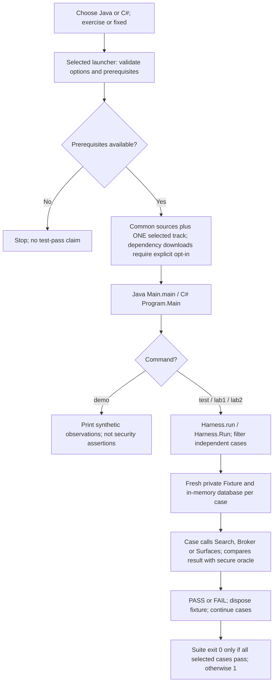

# Development and security operations lab — Java and C# tracks

Local, synthetic, intentionally vulnerable **exercise** and reference **fixed** tracks matching the document-search, mock-broker, same-class sweep and race activities in module 03. Never deploy the exercise track.

Choose **one language and one implementation track** in the existing [module 03 route](https://github.com/0xdarkfloyd/securecodingtraining/blob/main/03-development-and-security-operations-lab.md); do not double the workload. Java uses Java 17-targeted JDBC/H2; [C#/.NET guide](dotnet/README.md) uses net8.0/C# 12 and SQLite. Both are console fixtures, not Spring/ASP.NET APIs. Keep common fixtures and independent expectations unchanged, including the user-maintained [Java fixture](common/src/training/operations/Fixture.java).

**Print copies:** [complete PDF index in the training repository](https://github.com/0xdarkfloyd/securecodingtraining/blob/main/build/labs/README.md) includes this guide, Lab 1/Lab 2, Java/C# prompts, walkthroughs, keys and separate common/exercise/fixed source appendices. Withhold instructor keys and fixed code until debrief.

## Paired code and teaching guides

**Beginner route:** start with [simple exercises and Copilot prompts](docs/BEGINNER-EXERCISES.md), then compare with the separate [beginner solutions](solutions/BEGINNER-SOLUTIONS.md). Three tasks cover security weaknesses, untrusted data/boundaries and race/retry correctness. Use them in place of equivalent initial analysis tasks, not as added mandatory class time. Java and C# share the questions; no code or test oracle is changed.

| Activity | Java exercise / reference fixed | C# exercise / reference fixed |
|---|---|---|
| Search / Lab 1 | [exercise](exercise/src/training/operations/Search.java) / [fixed](fixed/src/training/operations/Search.java) | [exercise](dotnet/exercise/src/Search.cs) / [fixed](dotnet/fixed/src/Search.cs) |
| Broker / Lab 2 | [exercise](exercise/src/training/operations/Broker.java) / [fixed](fixed/src/training/operations/Broker.java) | [exercise](dotnet/exercise/src/Broker.cs) / [fixed](dotnet/fixed/src/Broker.cs) |
| Surfaces / sweep and races | [exercise](exercise/src/training/operations/Surfaces.java) / [fixed](fixed/src/training/operations/Surfaces.java) | [exercise](dotnet/exercise/src/Surfaces.cs) / [fixed](dotnet/fixed/src/Surfaces.cs) |

Java: [walkthrough](docs/WALKTHROUGH.md), [bounded prompts](docs/COPILOT-PROMPTS.md), [reference key](solutions/README.md), [observed validation](VALIDATION.md). C#: [student guide](dotnet/GUIDE.md), [bounded prompts](dotnet/COPILOT-PROMPTS.md), [reference key](dotnet/SOLUTIONS.md), [validation blocker](dotnet/VALIDATION.md). Reveal fixed code/keys after manual findings and independent oracles; do not compile both implementations together.

**Evidence status:** the previous Java fixed run passed **37/37**, exercise **7 PASS / 30 FAIL**, on JDK 21.0.2 with `--release 17`; actual Java 17 runtime was not tested. These are historical results, not a new run of the current source. C# targets **net8.0/C# 12**, requiring an approved **SDK 8+** and suitable runtime; the recorded available SDK is **2.1.526 only**. Neither C# project has been compiled or executed. Its 37 fixed cases are **expected**, not passed. No installation, restore or execution is performed by this integration.

## Program flow — select, build and observe

Java additionally supports launcher-only `build` and `-List`; these do not enter the test harness. Lab 1 selects 12 search cases, Lab 2 selects 25 broker/surface/race cases, and `test` selects all 37. Both tracks use the **same secure expectations**: an exercise failure remains a failure. Entry points: [Java Main](common/src/training/operations/Main.java), [C# Program](dotnet/Common/Program.cs); assertions: [Java Harness](common/src/training/operations/Harness.java), [C# Harness](dotnet/Common/Harness.cs).

## Function flow — fixed security gates

These are **two separate calls**, not a search-then-tool pipeline. Java names are shown with their C# equivalents. Identity comes from trusted fixture state, never a model-supplied principal or supplier. Dashed broker edges represent exceptions during the guarded execution path.

```mermaid
flowchart TD
	subgraph SearchFlow["Lab 1: Search.search / Search.Find"]
		S1["Fixture.authenticate / Authenticate"] --> S2{"Recognised identity?"}
		S2 -- No --> S401["Return 401; no query"]
		S2 -- Yes --> S3["Acquire policy lock"]
		S3 --> S4{"Current supplier scope?"}
		S4 -- No --> S403["Return 403; no query"]
		S4 -- Yes --> S5{"Nonblank name; at most 100 characters?"}
		S5 -- No --> S400["Return 400; no query"]
		S5 -- Yes --> S6["Bind trusted supplier and name; select ID/name only; bounded query"]
		S6 --> S7["Execute SQL; return summary DTOs with 200; database failure returns safe 500"]
	end
	subgraph BrokerFlow["Lab 2: Broker.call / Broker.Call"]
		B1["Validate registered tool and exact documentId integer schema"] --> B2{"Valid proposal?"}
		B2 -- No --> Reject["REJECTED"]
		B2 -- Yes --> B3{"Trusted requester; permitted tool and resource?"}
		B3 -- No --> Deny["DENIED"]
		B3 -- Yes --> B4{"Atomic Budget.reserve / Reserve succeeds?"}
		B4 -- No --> Quota["STOPPED"]
		B4 -- Yes --> B5["afterInitialCheck hook; acquire policy lock"]
		B5 --> B6{"Recheck current permission under lock"}
		B6 -- No --> Deny
		B6 -- Yes --> B7["Mark reservation consumed; materialize content and record mock effect under lock"]
		B7 --> Allow["ALLOWED with content"]
		B5 -. exception .-> Fail["FAILED; no content returned"]
		B7 -. exception .-> Fail
		Reject --> Final["Finally: refund only reserved-but-unconsumed quota; audit decision only"]
		Deny --> Final
		Quota --> Final
		Allow --> Final
		Fail --> Final
	end
```

- Search authorization and SQL binding are **independent controls**. Java uses `PreparedStatement` with a two-second timeout and 100-row limit; C# uses SQLite parameters and corresponding bounds. See [Java Search](fixed/src/training/operations/Search.java) / [C# Search](dotnet/fixed/src/Search.cs).
- Broker ownership checks use internal, non-disclosing metadata **before content**. Supplier `approveRisk` is denied even though its name is registered. A started content read consumes quota even if it fails; a reservation abandoned before that point is refunded. The shared lock makes the final permission check and use atomic relative to fixture revocation. See [Java Broker](fixed/src/training/operations/Broker.java) / [C# Broker](dotnet/fixed/src/Broker.cs).
- [Java Surfaces](fixed/src/training/operations/Surfaces.java) / [C# Surfaces](dotnet/fixed/src/Surfaces.cs) extend the permission-before-content rule to read/preview/download/storage. Export authorizes **all items before any content**; tenant-scoped cache hits recheck current permission; jobs recheck at enqueue, execution and delivery. Race hooks are deterministic test seams, not production callbacks.
- These console flows do not demonstrate HTTP middleware, JWT validation, live model execution or production deployment. The function diagram describes reference source behavior, not new runtime evidence.

## Java prerequisites and commands

- A JDK supporting Java 17; `java` and `javac` on PATH. No Maven, Spring, JUnit, web server or AI account needed.
- Windows PowerShell 5.1 or PowerShell 7. Review [lab.ps1](lab.ps1) and [dependencies.ps1](dependencies.ps1) before running. Do not bypass an organisational execution policy.
- From the parent workspace, first run `& .\development-operations-lab\lab.ps1 -Track fixed -Command test -DownloadDependencies`.
- Subsequent offline commands: `& .\development-operations-lab\lab.ps1 -Track exercise -Command demo`, `& .\development-operations-lab\lab.ps1 -Track exercise -Command test`, and `& .\development-operations-lab\lab.ps1 -Track fixed -Command test`.
- `-Command lab1` runs the 12 search tests; `-Command lab2` runs the 25 broker/sweep/race tests. `-Command build` compiles only. `-Track fixed -List` lists tracks/commands without building or networking.
- `-Track` is required, selecting `exercise` or `fixed`. Default command is `demo`. Only explicit `-DownloadDependencies` permits downloading a missing dependency.

All 37 tests use the same secure expectations on both tracks. Exercise failures are **FAIL**, not inverted passes, and return exit code 1. A successful fixed test suite returns 0. Demo prints observations and returns 0 if it completes; demo is not a security assertion.

## C# prerequisites and launcher

Read the [C# README](dotnet/README.md), [launcher](dotnet/lab.ps1) and [NuGet configuration](dotnet/NuGet.Config) before execution. Provision an approved SDK 8+ separately; this pack does not install software or change policy. From the parent workspace, the first selected-track invocation is `& .\development-operations-lab\dotnet\lab.ps1 -Track fixed -Command test -Restore` (substitute `exercise` for student work). `-Restore` explicitly permits NuGet HTTPS downloads, including transitive/native SQLite dependencies. Later `test`, `lab1`, `lab2` or `demo` invocations omit `-Restore` when assets exist; the script uses `dotnet run --no-restore` and checks SDK selection first. Unlike Java, the C# launcher has no `build`, `-List` or `-DownloadDependencies` option.

The recorded old-SDK prerequisite check returned **exit 2** before restore/build, not a compiler/test result. An appropriate runtime/targeting pack may also be required with a newer SDK. Expected subsets are 12 search and 25 broker/sweep/race cases; exercise failures must remain FAIL/nonzero. Use paper/source review if prerequisites are unavailable; never copy expected output into actual-result cells.

## Layout

- [common/src/training/operations](common/src/training/operations): fixture, contracts, quota, CLI, model samples and independent harness, defined once.
- [exercise/src/training/operations](exercise/src/training/operations): unsafe `Search`, `Surfaces`, `Broker`.
- [fixed/src/training/operations](fixed/src/training/operations): reference implementations with **the same package/class names**.
- [docs/lab1/README.md](docs/lab1/README.md), [docs/lab2/README.md](docs/lab2/README.md): participant scenarios.
- [docs/WALKTHROUGH.md](docs/WALKTHROUGH.md), [docs/COPILOT-PROMPTS.md](docs/COPILOT-PROMPTS.md): source map and review prompts.
- [solutions/README.md](solutions/README.md): instructor explanations, oracle inventory and limitations.
- [DEPENDENCIES.md](DEPENDENCIES.md): artifact provenance and pin.

The build compiles common sources plus **one track only**, into an isolated output directory with `javac --release 17`. Compiling both tracks together is intentionally invalid. H2 is loaded as a JDBC library on the classpath; neither script uses `java -jar` or runs downloaded commands. No POSIX wrapper is supplied.

For Java editor analysis, open [fixed.code-workspace](fixed.code-workspace) or [exercise.code-workspace](exercise.code-workspace) as a separate workspace. They configure common plus one selected source root only. The parent workspace's automatic Java discovery may show unresolved/duplicate-class diagnostics across the intentionally overlapping tracks; the successful selected-track `javac` builds are the compilation evidence. No parent editor configuration is changed.

## What this demonstrates

Actual H2 2.3.232 relational SQL executes against a fresh, private in-memory database per test. The exercise uses JDBC `Statement`, concatenates a name into `SELECT *`, lacks a supplier predicate/bounds and logs the authentication header. The fixed search uses actual JDBC `PreparedStatement`, two bound values, a supplier predicate and an explicit `{id,name}` response projection.

The **console adapter**, not HTTP routing, returns a numeric `status` representing the intended API contract: 200 success, 401 unrecognised/missing fixture identity, 403 missing/revoked scope or resource denial, 400 invalid input, 500 safe database failure. It is **not Spring Security, authentication middleware or JWT validation**. Real API integration must test those boundaries separately.

Fixed fixture tokens are `ALICE-DEMO`, `BOB-DEMO`, `NOSCOPE-DEMO` with an exact `Bearer ` prefix. Their trusted principal/supplier mapping resides outside request/model payload in the fixture. They are synthetic labels, not production credentials. The model cannot submit a principal or supplier through the broker schema. Internal Java identities are trusted server objects, not deserialised inputs.

| ID | Supplier | Exact name |
|---|---|---|
| 101 | SUP-A | Contract |
| 102 | SUP-B | Contract |
| 103 | SUP-A | O'Reilly Guide |

`extraSensitiveField`, supplier and content fields appear only in the exercise's full-entity search output. The fixed search returns only ID/name. Source/model outputs and all tool effects are synthetic; there is no outbound tool, HTTP target or external authentication request. Network access is only the optional fixed-origin dependency download.

See [solutions/README.md](solutions/README.md) before making any production-security claim.